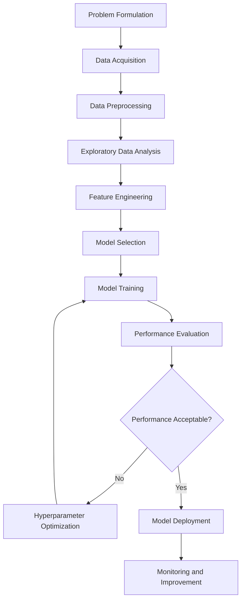

# Hi, I'm Chinmayee S 👋

### AI/ML Engineering Student | Software Developer | Applied AI Research Enthusiast

  

  
  
  

---

## 👩‍💻 About Me

I am an Artificial Intelligence and Machine Learning engineering student at BNM Institute of Technology, Bengaluru, with a strong interest in applied artificial intelligence, computational intelligence, software engineering and emerging technologies.

My technical focus involves understanding and developing intelligent systems through algorithmic problem-solving, data-driven decision-making, machine learning methodologies and efficient software architectures.

I am passionate about bridging the gap between theoretical computer science concepts and practical engineering applications through continuous learning, research, experimentation and innovation.

- 🎓 Artificial Intelligence and Machine Learning
- 🏫 BNM Institute of Technology, Bengaluru
- 🔬 Applied AI and Research Enthusiast
- 💻 Software Development and Algorithmic Problem Solving
- 🌐 Exploring Emerging and Immersive Technologies
- 🤝 Open to Internships, Freelancing and Technical Collaborations

---

## ⚡ Technical Stack

### Programming Languages

### Artificial Intelligence & Machine Learning

### Web Development

### Geospatial & Immersive Technologies

### Development Environment & Version Control

---

## 🧠 Technical Competencies

| Technical Domain | Concepts & Methodologies |
|---|---|
| Artificial Intelligence | Intelligent Systems, Applied AI, Computational Intelligence |
| Machine Learning | Supervised Learning, Unsupervised Learning, Classification, Regression, Clustering |
| ML Algorithms | KNN, Decision Trees, Random Forest, K-Means, DBSCAN |
| Model Evaluation | Accuracy, Precision, Recall, F1-Score, ROC-AUC, Cross-Validation |
| Computer Vision | Image Processing, Object Detection, Feature Extraction, Image Classification |
| Data Analytics | Data Cleaning, Exploratory Data Analysis, Feature Engineering, Visualization |
| Dimensionality Reduction | PCA, LDA, Random Projection, LLE |
| Time Series Analysis | Trend, Seasonality, Autocorrelation, Forecasting |
| Edge Intelligence | TinyML, Keyword Spotting, Model Optimization Concepts |
| Software Engineering | SDLC, Modular Architecture, MVC, System Design |
| Object-Oriented Programming | Encapsulation, Inheritance, Polymorphism, Abstraction |
| Data Structures | Arrays, Collections, Searching, Sorting |
| Operating Systems | Process Management, Scheduling, Memory Management, IPC |
| Computer Networks | TCP/IP, OSI Model, Network Protocols, IP Addressing, Subnetting |
| Cybersecurity | Cryptography, Information Security, Network Security Fundamentals |
| Geospatial Analytics | Raster Processing, Spectral Indices, Remote Sensing, Change Detection |
| Immersive Computing | 3D Rendering, Virtual Reality, WebXR |

---

## 🤖 AI/ML Engineering Methodology

### Model Development and Evaluation

- Data preprocessing and normalization
- Feature extraction and feature selection
- Training, validation and testing strategies
- Cross-validation methodologies
- Hyperparameter tuning
- Confusion matrix analysis
- Bias-variance trade-off
- Overfitting and underfitting analysis
- Model generalization
- Computational efficiency
- Inference latency analysis

---

## 💻 Software Engineering Foundations

### Programming & Algorithmic Problem Solving

- Object-Oriented Programming
- Data Structures and Algorithms
- Modular Programming
- Exception Handling
- Input Validation
- Time and Space Complexity
- Searching and Sorting Techniques
- Debugging and Code Optimization

### Software Development Principles

- Software Development Life Cycle
- Requirement Analysis
- Software Design and Architecture
- Modular System Development
- Software Testing and Validation
- Version Control and Collaboration
- Technical Documentation
- Maintainability and Scalability Concepts

### Computer Science Fundamentals

- Operating System Architecture
- CPU Architecture and Instruction Processing
- Process and Thread Management
- Interprocess Communication
- Computer Networking
- Database Management Concepts
- Information Security
- Cryptographic Fundamentals
- Probability and Statistics
- Linear Algebra for Machine Learning

---

## 🔬 Research & Technical Interests

- Applied Artificial Intelligence
- Deep Learning Architectures
- Real-Time Computer Vision
- Edge AI and TinyML
- Intelligent Automation
- Geospatial Intelligence
- Model Compression and Quantization
- Explainable Artificial Intelligence
- Extended Reality and Spatial Computing
- Generative AI and Large Language Models
- Sustainable Technology Solutions
- Human-Computer Interaction

---

## 🏆 Certifications & Professional Development

| Certification | Issuing Organization |
|---|---|
| Fundamentals of Cryptography | Infosys Springboard |
| Fundamentals of Information Security | Infosys Springboard |
| Cascading Style Sheets | Infosys Springboard |
| PHP Tutorial | Coursera |
| C++ Essentials 1 | Cisco Networking Academy |
| Course on JavaScript | Infosys Springboard |
| Creating a Multi Page App using HTML and CSS | Coursera |
| C++ Code like you are in MATRIX | Udemy |
| Programming Using C++ | Infosys Springboard |
| Project on C++ | Infosys Springboard |

[View Professional Profile & Certifications](https://www.linkedin.com/in/chinmayee-s-4a7694333/)

---

## 📚 Currently Exploring

### Professional Learning Roadmap

- Advanced Machine Learning
- Deep Neural Networks
- Full-Stack Application Development
- REST API Architecture
- Cloud Computing and Deployment
- Machine Learning Operations (MLOps)
- Generative AI Engineering
- Large Language Model Integration
- Scalable Software Architecture
- Containerization and Deployment

---

## 📊 GitHub Analytics

  
  

### 🔥 Contribution Streak

  

### 📈 Contribution Activity

### 🏅 GitHub Trophies

  

---

## 🤝 Open to Professional Opportunities

- Artificial Intelligence and Machine Learning Internships
- Software Engineering Internships
- Python and Java Development
- Computer Vision Applications
- Freelance Software Development
- Research and Development
- Technical Collaborations
- Hackathons and Innovation Challenges
- Open-Source Contributions

---

## 🌐 Connect With Me

  
  

---

  <b>Research. Engineer. Optimize. Innovate.</b>

  Leveraging computational intelligence, algorithmic thinking and software engineering to build meaningful technological solutions.

  

