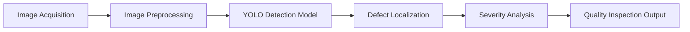
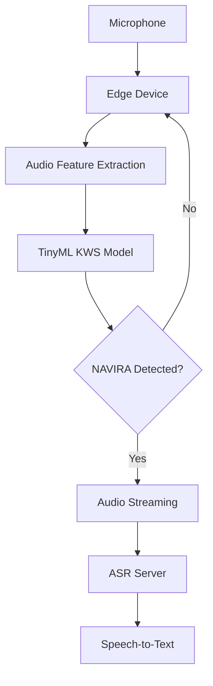
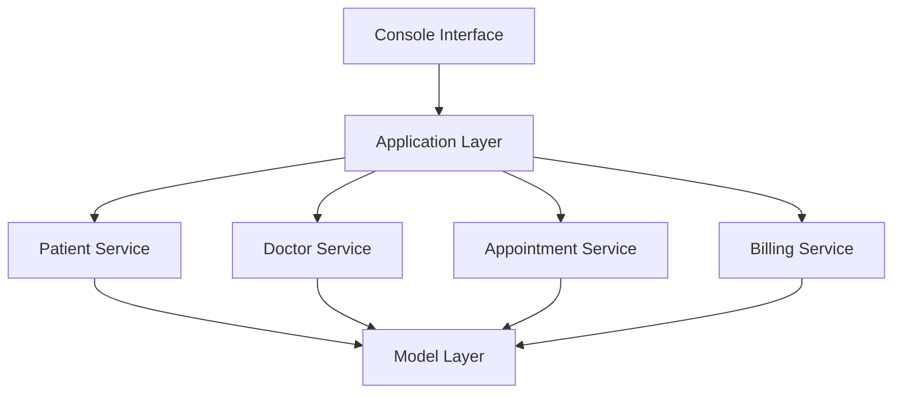
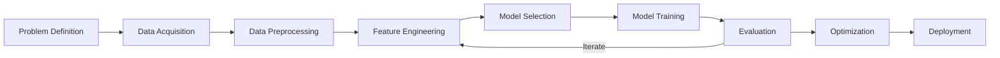

# Hi, I'm Chinmayee S 👋

### AI/ML Engineer in Development | Software Developer | Applied AI Research Enthusiast

  

  
  
  

---

## 01 | Engineering Profile

I am an Artificial Intelligence and Machine Learning engineering student at BNM Institute of Technology, Bengaluru, focused on developing intelligent, data-driven and computationally efficient software solutions.

My technical interests span applied machine learning, computer vision, edge intelligence, geospatial analytics, software engineering and immersive computing.

I am particularly interested in translating theoretical machine learning concepts into practical systems through data preprocessing, feature engineering, model development, performance evaluation and application integration.

### Core Technical Interests

- Artificial Intelligence and Applied Machine Learning
- Computer Vision and Intelligent Image Processing
- Edge AI and Resource-Constrained Machine Learning
- Software Architecture and System Design
- Geospatial Intelligence and Remote Sensing
- Full-Stack Application Development
- Extended Reality and Interactive 3D Systems
- Algorithmic Problem Solving

---

## 02 | Technical Stack

### Programming Languages

### AI, Machine Learning & Computer Vision

### Web Technologies

### Geospatial & Immersive Technologies

### Development Tools & Version Control

---

## 03 | Technical Competencies

| Domain | Technical Concepts |
|---|---|
| Machine Learning | Supervised Learning, Unsupervised Learning, Classification, Regression, Clustering |
| Model Evaluation | Accuracy, Precision, Recall, F1-Score, ROC-AUC, Cross-Validation |
| Computer Vision | Image Preprocessing, Object Detection, Feature Extraction, Defect Localization |
| Data Science | Exploratory Data Analysis, Data Cleaning, Feature Engineering, Visualization |
| Dimensionality Reduction | PCA, LDA, Random Projection |
| Edge AI | TinyML, Keyword Spotting, Model Quantization Concepts |
| Software Engineering | OOP, Modular Architecture, Exception Handling, MVC Concepts |
| Data Structures | Arrays, Collections, Searching, Sorting |
| Operating Systems | Process Management, Scheduling, Memory Management, IPC |
| Computer Networks | TCP/IP, OSI Model, Network Protocols, Subnetting |
| Cybersecurity | Cryptography, Information Security, Network Security Fundamentals |
| Geospatial Analytics | Raster Processing, Spectral Indices, Spatial Analysis, Change Detection |
| Immersive Computing | 3D Rendering, Scene Management, WebXR, Interactive Environments |

---

## 04 | Featured Engineering Projects

### 01. AI-Based Industrial Defect Inspection

**Domain:** Computer Vision | Industrial Automation | Applied AI

An AI-driven visual inspection project designed to investigate automated defect detection in paper manufacturing and 3D-printed products.

#### Proposed System Architecture

#### Technical Focus

- Camera-based visual inspection
- Image preprocessing and normalization
- YOLO-based defect detection
- Bounding box localization
- Defect classification and severity estimation
- Inference latency and throughput analysis
- Conveyor belt speed optimization
- Evaluation of camera-only inspection approaches

**Technology Stack:** Python, OpenCV, YOLO, Computer Vision

**Status:** Research and Development

---

### 02. NAVIRA — Edge AI Keyword Spotting

**Domain:** TinyML | Edge Computing | Speech Processing

A keyword-activated speech processing architecture designed to reduce unnecessary audio transmission through on-device keyword detection.

#### Proposed System Architecture

#### AI/ML Research Components

- Keyword spotting for the wake word NAVIRA
- Audio preprocessing and feature extraction
- Positive, negative and background-noise sampling
- Data augmentation strategies
- Lightweight neural network architectures
- Quantization and model compression strategies
- Confidence threshold optimization
- False Acceptance Rate and False Rejection Rate
- Inference latency and memory footprint evaluation

**Technology Focus:** TinyML, Keyword Spotting, Audio Signal Processing, Edge AI

**Status:** AI/ML Research and System Design

---

### 03. TerraSync — Blue Carbon Monitoring

**Domain:** Geospatial AI | Remote Sensing | Environmental Intelligence

A satellite-based mangrove monitoring project focused on identifying spatial and temporal vegetation changes in the Gulf of Kachchh, Gujarat.

#### Technical Specifications

| Parameter | Specification |
|---|---|
| Study Area | Jamnagar coastal region |
| Area | 25 square kilometres |
| Satellite | Sentinel-2 Level-2A |
| Coordinate System | EPSG:32642 |
| Baseline | 11 March 2022 |
| Comparison | 10 March 2025 |
| Spectral Bands | B02, B03, B04, B08, B11, B12 |
| Spectral Indices | NDVI, MNDWI |
| Reference Dataset | Global Mangrove Watch |

#### Processing Pipeline

#### Technical Contributions

- Multispectral satellite imagery preprocessing
- Raster clipping and coordinate transformation
- Scene Classification Layer masking
- NDVI and MNDWI computation
- Candidate mangrove and non-mangrove identification
- Multitemporal spatial analysis
- Geospatial visualization

Global Mangrove Watch is used as candidate reference data rather than independent ground truth.

**Technology Stack:** QGIS, Sentinel-2, GIS, Remote Sensing

**Status:** Preprocessing Completed; Change Analysis in Development

---

### 04. Hospital Management System

**Domain:** Java | Object-Oriented Programming | Software Engineering

A modular Java console application designed to manage hospital operations through structured service and model layers.

#### System Architecture

#### Functional Modules

- Patient registration and automatic ID generation
- Doctor registration and scheduling
- Appointment booking and cancellation
- Symptom-based specialist recommendation
- Appointment searching
- Billing and record management

#### Engineering Concepts

- Object-Oriented Programming
- Encapsulation and Abstraction
- Classes and Objects
- Modular Service Architecture
- Arrays and Collections
- Linear Search
- Exception Handling
- Input Validation
- Java Date and Time Handling

**Technology Stack:** Java, Git, GitHub

**Status:** Functional Console Application

---

### 05. Mjolnir Worthiness VR

**Domain:** Virtual Reality | Interactive 3D Graphics | Web Development

An immersive browser-based virtual reality game exploring interactive 3D environments and physics-inspired gameplay.

#### Technical Focus

- Three-dimensional scene construction
- Camera and lighting configuration
- 3D asset integration
- Interactive object manipulation
- Game-state management
- WebXR session integration
- Frontend and backend communication
- Browser-based rendering

**Technology Stack:** Three.js, JavaScript, WebXR, Vite

**Status:** Under Development

---

## 05 | AI/ML Development Methodology

### Model Evaluation Focus

- Classification Accuracy
- Precision and Recall
- F1-Score
- Confusion Matrix
- ROC-AUC
- Cross-Validation
- Inference Latency
- Computational Complexity
- Memory Utilization
- Model Generalization

---

## 06 | Certifications & Professional Development

| Certification | Issuing Organization |
|---|---|
| Fundamentals of Cryptography | Infosys Springboard |
| Fundamentals of Information Security | Infosys Springboard |
| Cascading Style Sheets | Infosys Springboard |
| PHP Tutorial | Coursera |
| C++ Essentials 1 | Cisco Networking Academy |
| Course on JavaScript | Infosys Springboard |
| Creating a Multi Page App using HTML and CSS | Coursera |
| C++ Code like you are in MATRIX | Udemy |
| Programming Using C++ | Infosys Springboard |
| Project on C++ | Infosys Springboard |

[View Certifications on LinkedIn](https://www.linkedin.com/in/chinmayee-s-4a7694333/)

---

## 07 | Computer Science Foundations

- Data Structures and Algorithms
- Object-Oriented Programming
- Software Engineering Principles
- Operating System Architecture
- CPU Architecture and Instruction Processing
- Computer Networks and Communication Protocols
- Database Management Concepts
- Information Security and Cryptography
- Probability and Statistics
- Mathematical Foundations of Machine Learning

---

## 08 | Currently Exploring

### Research and Learning Roadmap

- Deep Neural Network Architectures
- Real-Time Object Detection
- Model Compression and Quantization
- Machine Learning Operations (MLOps)
- REST API Development
- Full-Stack System Integration
- Cloud-Based Model Deployment
- Explainable Artificial Intelligence
- Generative AI and Large Language Models

---

## 09 | GitHub Analytics

  
  

  

### Contribution Activity

---

## 10 | Engineering Opportunities

Open to collaborating on:

- Applied AI and Machine Learning Projects
- Computer Vision Applications
- Software Development
- Research and Technical Innovation
- Freelance Development Projects
- AI/ML and Software Engineering Internships
- Open-Source Contributions
- Interdisciplinary Engineering Projects

---

## 11 | Professional Connectivity

  
  

---

  <b>Research. Engineer. Optimize. Innovate.</b>

  Transforming computational intelligence into practical engineering solutions.

